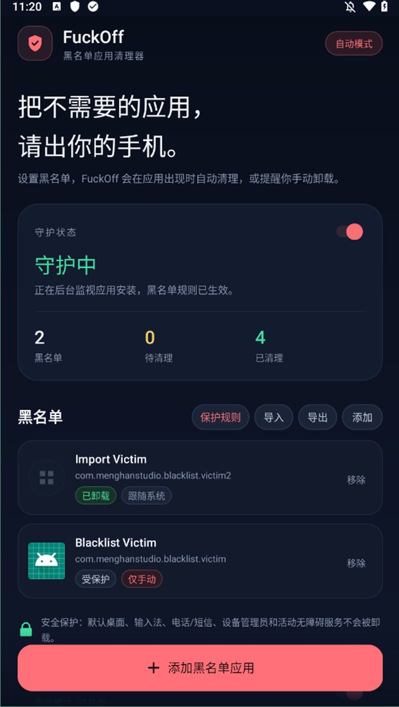
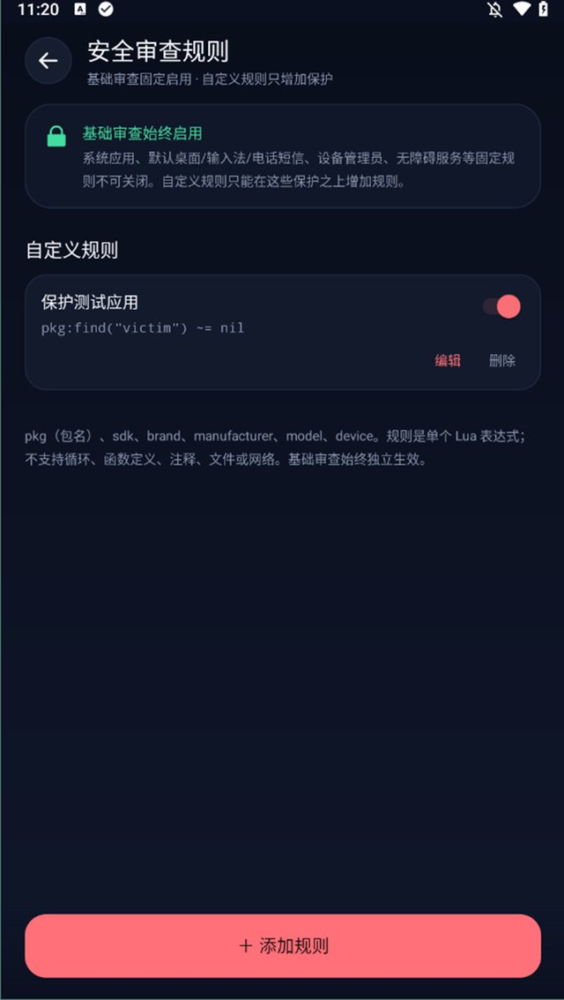
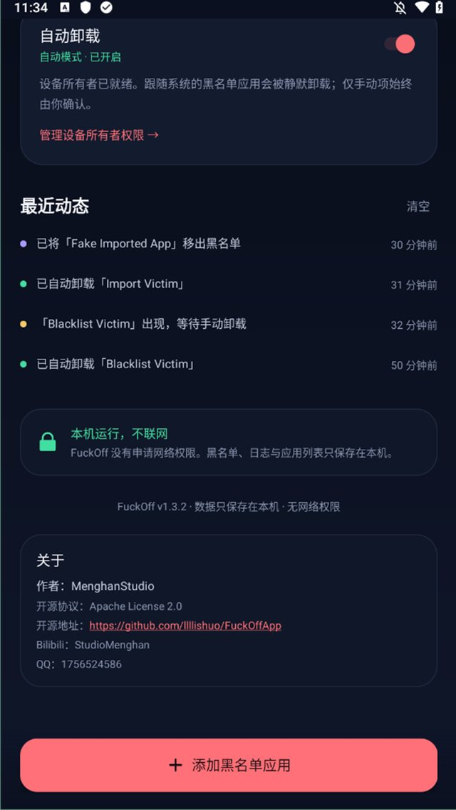

## 它解决什么问题

手机上总有几个应用是你不想留的：装了删不掉、删了又自己回来、或者留着就会一直刷。

FuckOff 把决定权交回给你：**你自己指定一份黑名单**，之后只要黑名单里的应用出现在手机上，FuckOff 就按你选的清理方式处理——发一条通知让你确认，或者直接静默卸载。

它只处理你主动拉黑的**用户应用**，不碰系统应用；所有数据留在本机，**没有申请网络权限**。

## 视频演示

<div class="video-shell">
  <div class="phone">
    <video controls playsinline preload="metadata"
           poster="/assets/img/projects/fuckoff/poster.jpg">
      <source src="/assets/video/fuckoff-intro-v1.7.0.mp4" type="video/mp4">
      <track kind="captions" src="/assets/video/fuckoff-intro-v1.7.0.vtt"
             srclang="zh" label="中文" default>
      你的浏览器不支持 video 标签，可以<a href="/assets/video/fuckoff-intro-v1.7.0.mp4">直接下载 MP4</a>。
    </video>
  </div>
  <p class="video-caption">
    50 秒竖屏介绍（东北话旁白 + 中文字幕）：黑名单、四种清理方式、通知与灵动岛、
    后台守护、安全审查。画幅 720×1280，H.264。
  </p>
</div>

## 界面

<div class="shot-grid">
  <figure class="shot">
    
    <figcaption>首页：黑名单、待清理数量、最近动态</figcaption>
  </figure>
  <figure class="shot">
    
    <figcaption>保护规则：基础审查固定，可加自定义规则</figcaption>
  </figure>
  <figure class="shot">
    
    <figcaption>关于页：版本、许可与联系方式</figcaption>
  </figure>
</div>

> 截图里有一条演示用的测试规则；新安装的 APK 默认没有任何自定义规则，基础审查始终启用。

## 四种清理方式

在首页「自动处理」卡片里点「清理方式」切换：

| 清理方式 | 需要什么 | 行为 |
| --- | --- | --- |
| 手动确认 | 无 | 只发通知，由你在系统卸载界面确认 |
| Device Owner | 已配置 Device Owner | 用系统 `PackageInstaller` 静默卸载 |
| Shizuku | 已安装并启动 Shizuku，且已授权 FuckOff | 通过本地 shell 执行 `pm uninstall --user 0` |
| 无障碍模拟确认 | 已开启 FuckOff 无障碍服务 | 系统卸载弹窗由无障碍服务自动点击确认 |

需要说清楚的是：**普通 Android 应用无法静默卸载其他应用。** 静默卸载必须靠 Device Owner（企业设备管理权限，通常需要恢复出厂或无账户环境）或 Shizuku（通过无线调试启动本地 shell）。两者都没有配置时，手动模式仍然完整可用。

无障碍模式是半自动的：它只替你点系统卸载弹窗的确认按钮，不会在后台偷偷卸载。

每个黑名单项还能单独选「跟随系统」或「仅手动」——从 JSON 导入的条目一律强制为「仅手动」，导入后也不会立刻触发清理。

## 后台怎么发现新装的应用

Android 8 之后，清单里注册的 `PACKAGE_ADDED` 广播在后台会被限制，只靠广播会漏。所以 FuckOff 用三层机制：

<ol class="steps">
  <li><strong>前台服务轮询</strong><p>守护服务每 3 秒比较一次已安装包集合。即使广播被系统拦掉，只要服务还活着，几秒内也能发现。</p></li>
  <li><strong>包变更广播</strong><p>应用在前台或进程活跃时，广播是最快路径；接收端用 goAsync 处理，不阻塞主线程。</p></li>
  <li><strong>10 分钟 Alarm 看门狗</strong><p>前台服务被系统杀掉后，AlarmManager 仍会唤醒一次扫描；JobScheduler 每 15 分钟再兜一层底。</p></li>
</ol>

首页的「后台守护设置」会列出荣耀 / MagicOS 需要打开的项（应用启动管理、电池优化、通知、最近任务锁定），并能直接跳到系统设置页。

## 不会误删：安全边界

为了避免把手机搞坏，下面这些**永远不会**进入卸载队列：

- Android 系统应用，以及设置、系统界面、包安装器、权限控制器等固定关键包
- 当前默认桌面（Launcher）、默认输入法、默认电话与短信应用
- 设备上正在生效的设备管理员、Profile Owner
- 已启用的无障碍服务（包括 FuckOff 自己）
- FuckOff 自身

它们不会出现在应用选择器里；就算通过旧数据或导入的 JSON 混进来，首页也会标成「受保护」并拒绝发送卸载请求。黑名单最多 200 条。

不同 Android 版本和 OEM 的关键角色不完全一样，所以「保护规则」允许在固定基础审查之上**追加**本地规则。每条规则是一个受限的 Lua 表达式，返回真值即视为受保护：

```lua
pkg == "com.example.launcher"
pkg:match("^com%.oem%.") ~= nil
sdk >= 31 and pkg:find("keyboard") ~= nil
```

可用变量有 `pkg`（包名）、`sdk`（API 级别）、`brand`、`manufacturer`、`model`、`device`。为了不让规则变成任意代码入口，只支持单个表达式：拒绝循环、函数定义、注释、长字符串和分号，也不提供 `os` / `io` / `package` / `load` / `luajava`。最多 50 条，单条 800 字符以内，只存在本机。

自定义规则**只能增加保护**，没有「允许卸载」这种写法；基础审查无法关闭。

## 安装与开启自动模式

<ol class="steps">
  <li><strong>侧载 APK</strong><p><code>adb install -r FuckOff-v1.7.0.apk</code>，或允许浏览器安装未知应用后直接点开。首次打开请给通知权限（Android 13+ 必需）。</p></li>
  <li><strong>先用手动模式</strong><p>不配置任何东西也能用：把应用加入黑名单，检测到就发通知，点通知进系统卸载界面确认。</p></li>
  <li><strong>想要静默卸载，再配 Device Owner</strong><p>装 adb，在应用内「自动卸载设置」里复制命令执行；应用会按当前安装包生成准确命令。配置前请备份数据——这是会改变设备管理状态的系统级操作。</p></li>
  <li><strong>或者用 Shizuku</strong><p>装 Shizuku 并启动、授权 FuckOff，就能在不需要 Device Owner 的情况下走 shell 卸载。Shizuku 服务没跑时会自动退回手动通知。</p></li>
</ol>

```bash
# Device Owner 命令由应用内生成，形如：
adb shell dpm set-device-owner com.menghanstudio.gooutpls/.admin.GoOutDeviceAdminReceiver
```

卸载本应用之前，请先在应用内取消设备所有者权限，否则系统可能会阻止卸载。

## 隐私

| 项目 | 说明 |
| --- | --- |
| 网络权限 | **没有** `INTERNET` 权限 |
| 数据存放 | 黑名单、设置、最近动态都写在本机 SharedPreferences |
| 分析 / 广告 SDK | 无 |
| 收集的数据 | 不收集设备标识、位置、通讯录、使用记录 |
| 导出备份 | 通过系统文件选择器读写 JSON，不申请存储权限 |

完整权限表见仓库 README。

## 已知边界

诚实地说清楚它做不到什么：

- 只支持当前用户空间，不处理多用户 / 工作资料里的应用
- 极端省电策略仍可能延迟处理；用户手动「强行停止」后监控暂停，要重新打开应用才恢复
- 无障碍服务是半自动，且需要用户手动开启；不同 OEM 的卸载弹窗按钮文案可能不同
- 荣耀的灵动胶囊没有公开的第三方按钮 SDK，FuckOff 用的是 Android 16 标准汇总通知，是否显示成胶囊由系统决定
- 自定义规则只是受限 Lua 表达式，需要循环和文件访问的复杂逻辑得在宿主机上算好包名再写简单规则
- 不提供远程管理、云同步或家长控制服务——它就是个本地工具

v1.7.0 的验证情况：Android 9 模拟器上跑通了 Device Owner、静默卸载、无障碍确认、Lua 规则、JSON 导入导出等端到端流程；荣耀真机上的后台保活、灵动胶囊、批量队列尚未做回归。细节见仓库里的 [TESTING.md](https://github.com/llllishuo/FuckOffApp/blob/main/TESTING.md)。

## 许可

Apache License 2.0，随 APK 打包 `LICENSE` 与 `NOTICE`。内置 LuaJ 3.0.1（受限规则表达式）和 Shizuku API 13.1.5（仅 Shizuku 模式使用），均为 MIT，声明见 [THIRD_PARTY_NOTICES.md](https://github.com/llllishuo/FuckOffApp/blob/main/THIRD_PARTY_NOTICES.md)。
