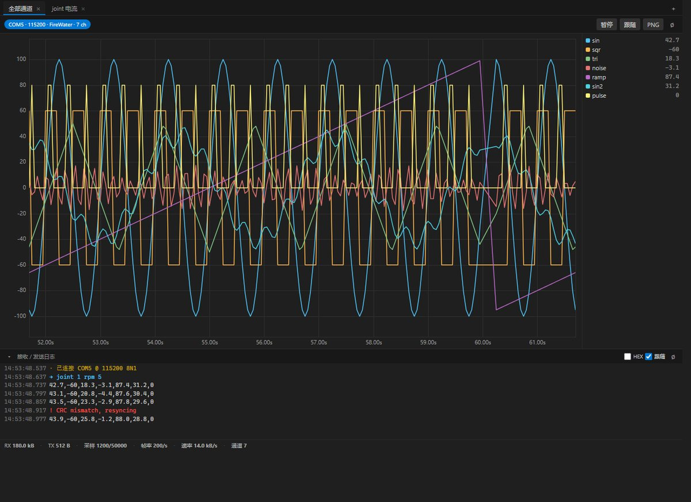
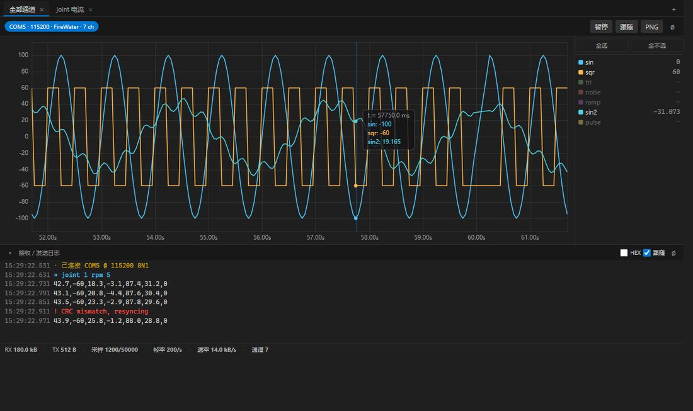
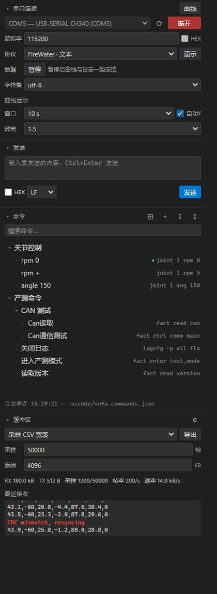
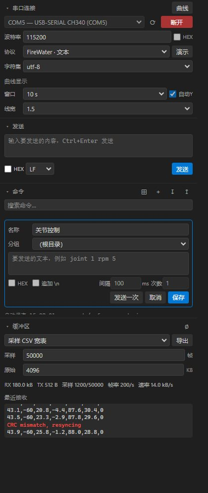

## 它解决什么问题

写单片机的时候，最常见的动作是：改完固件 → 想看波形 → 切到另一个串口工具 → 重新选端口、波特率、协议 → 波形出来 → 想发条命令试试 → 再切回去改代码。

VOFA Serial Studio 把这套来回切换砍掉了。它是一个 VS Code 扩展：**串口收发、协议解析、曲线绘制、命令点发、缓冲区导出**都在编辑器里完成，代码和波形并排看。

界面截图都是无头 Chrome 对生产构建的实际渲染，不是示意图。

## 曲线面板



多标签页、图例实时值、悬停读数、终端日志、状态栏统计都在一个面板里。**通道默认不启用**（在「通道」下拉里点开，或「全选」），悬停读数也只显示已启用的通道。



悬停看各通道数值，滚轮缩放时间轴，<kbd>Shift</kbd>+滚轮缩放 Y 轴，拖动平移，双击回到跟随模式；<kbd>Space</kbd> 暂停，<kbd>A</kbd> 切自动 Y。

每个标签页有自己的一组「显示哪些通道」，共用同一份采样缓冲——比如「全部通道」和「只看电流」两页来回切。标签页最多 8 个，会持久化，重载窗口后恢复。

## 侧边栏

<div class="shot-grid two">
  <figure class="shot">
    
    <figcaption>串口连接 / 发送 / 命令 / 缓冲区，四个折叠块</figcaption>
  </figure>
  <figure class="shot">
    
    <figcaption>命令编辑：「所属分组」可移到任意层级</figcaption>
  </figure>
</div>

四块都是折叠栏：点标题折叠/展开，折叠后标题右侧仍显示一行摘要（`COM5 · 115200 · FireWater`、`63 条`、`RX 180.0 kB · 1200 帧`）。每块都能拖高、拖顺序，下次打开还是你排的样子。

**设置都在侧边栏，曲线面板只负责展示**：横轴窗口（2s–60s / 全部）、线宽、自动 Y，以及缓冲区容量（采样帧数 5k–200k、原始字节 KB）都在这里改，改完立即生效。

## 五个环节

<div class="feature-grid">
  <div class="feature">
    <h4>串口收发</h4>
    <p>端口枚举、波特率/数据位/停止位/校验/流控/DTR/RTS，收发双向，UTF-8 / GBK / ASCII / Latin1 解码。</p>
  </div>
  <div class="feature">
    <h4>协议解析</h4>
    <p>FireWater（文本）、JustFloat（float32 + 帧尾）、RawData（原样）、Custom（自定义帧头帧尾 + 8 种数值类型）。</p>
  </div>
  <div class="feature">
    <h4>曲线绘制</h4>
    <p>Canvas 2D 自绘，逐像素 min/max 降采样；多标签页、缩放平移、自动 Y、滚动窗口、暂停。</p>
  </div>
  <div class="feature">
    <h4>命令库</h4>
    <p>树状分组、备注、HEX、循环发送与次数；一键导入现有 vofa+.cmds.json，也能导回去。</p>
  </div>
  <div class="feature">
    <h4>缓冲区导出</h4>
    <p>采样 CSV（宽表/长表）、JSON、原始 .bin、hex dump、收发日志、曲线 PNG。</p>
  </div>
  <div class="feature">
    <h4>无硬件也能验证</h4>
    <p>内置演示数据源：7 通道合成信号，按真协议编码后再解码，整条链路跑通。</p>
  </div>
</div>

## 固件侧怎么写

**FireWater（文本，最省事）**：每帧一行，通道用逗号分隔。

```c
printf("%d,%.3f,%.3f\n", (int)rpm, iq, id);
```

字段可以带名字，`sin:0.5,cos:0.8` 会直接显示在图例上；纯日志行会被忽略，可以和数字行混在同一个串口里。注意 newlib-nano 下浮点 printf 要加 `-u _printf_float`，否则打出来是空的。

**JustFloat（二进制，最省带宽）**：N 个小端 float32 + 4 字节帧尾 `00 00 80 7F`。

```c
static const uint8_t kTail[4] = {0x00, 0x00, 0x80, 0x7F};

void vofa_justfloat(const float *v, uint8_t n)
{
    uart_write((const uint8_t *)v, n * sizeof(float));  /* 小端 CPU 直接发 */
    uart_write(kTail, sizeof(kTail));
}
```

Cortex-M 全系小端，`float` 数组可以直接当字节数组发；帧尾不能省，解析器靠它切帧，帧内通道数由帧长自动推断，偶发杂字节会自动重同步。

**Custom** 适合已有自有协议的固件——不用改下位机，把帧头帧尾填对就行：

```
AA 55 | float32 × N | 0D 0A
```

## 安装

**方式 A：装 vsix（推荐）**

```powershell
# 从 Releases 下载最新的 .vsix，或自己打一个
npm install
npm run package                       # 产出 vofa-serial-studio-<version>.vsix
code --install-extension .\vofa-serial-studio-0.2.0.vsix
```

装完重启或重载 VS Code 窗口。

**方式 B：源码调试**

```powershell
git clone https://github.com/llllishuo/vofa-vscode.git
cd vofa-vscode
npm install
npm run compile
```

用 VS Code 打开该目录，按 <kbd>F5</kbd> 启动扩展开发宿主。

```powershell
npm run typecheck   # tsc --noEmit
npm test            # 协议/环形缓冲/导出/命令树 + 会话级全链路 + 激活冒烟（353 项）
```

## 快速上手

<ol class="steps">
  <li><strong>打开侧边栏</strong><p>左侧活动栏点 VOFA 图标 → 「串口 / 命令」。</p></li>
  <li><strong>连上串口</strong><p>选端口（如 <code>COM5 — USB-SERIAL CH340</code>）和波特率，点「连接」。</p></li>
  <li><strong>看波形</strong><p>选协议（默认 FireWater）→ 点右上「曲线」，波形即时出现；再点一次「关闭」收起面板。</p></li>
  <li><strong>没有硬件？</strong><p>点「演示」，7 通道合成信号立刻跑起来。</p></li>
</ol>

## 命令库与 VOFA+ 互操作

命令里保存的永远是**十六进制字节**（和 VOFA+ 的 `cmd_hex` 一致），所以文本、HEX、非打印字节都不会在往返中丢失。

- 点击命令名 = 发送一次；点 `⟳` = 按间隔循环发送（运行中显示 `■` 和绿点）
- **自动保存**：命令库是真实文件，改完 400 ms 落盘——有工作区时写在 `<工作区>/.vscode/vofa.commands.json`（可以进 git、直接 diff），没有工作区时写扩展全局存储
- `↧` 默认指向 `%LOCALAPPDATA%\VOFA+\<version>\context\vofa+.cmds.json`，63 条命令、分组、备注、循环参数原样进来
- `↥` 可以把当前命令库导出成 VOFA+ 格式，两边随时倒
- 命令面板（<kbd>Ctrl</kbd>+<kbd>Shift</kbd>+<kbd>P</kbd> → `VOFA: 发送已保存的命令…`）支持按路径模糊搜索

## 缓冲区与导出

| 导出项 | 内容 |
| --- | --- |
| 采样 CSV（宽表） | `序号,时间(ms),sin,sqr,…` 一行一帧，与 VOFA+ 宽表一致（带 BOM，Excel 直接开） |
| 采样 CSV（长表） | `序号,时间(ms),通道名称,数值`，与 VOFA+ 长表一致 |
| 采样 JSON | `{channels:[…], count, time:[…], data:[[ch0…],[ch1…]]}` |
| 原始 `.bin` | 接收到的字节原样保存，可用于离线复现 |
| 原始 hex | 带偏移与 ASCII 列的 hex dump |
| 接收日志 | `[相对秒] RX/TX/SYS 文本`，含发送记录 |
| 曲线 PNG | 当前画布截图 |

缓冲容量默认 50000 帧（对齐 VOFA+ 的 `buffer_max_size`），原始字节 4 MB，都能在侧边栏改。

## 性能

两个负载测试台可复现（`tools/load/`）。200 帧/秒 × 7 通道、10 秒同口径结果：

| 指标 | 0.1.2 | 0.1.3 |
| --- | --- | --- |
| 扩展宿主最长卡顿 | 674 ms | 无 > 60 ms |
| 扩展宿主事件循环 p95 / max | 49.4 / 673.9 ms | 13.5 / 33.6 ms |
| 扩展宿主 CPU | 5.0 % | 2.5 % |
| 曲线 webview 帧间隔 p95 | 33.4 ms | 16.7 ms |
| 曲线 webview 长任务 | 8 次 / 520 ms | 0 次 |

维持这个数字靠四条约束：热路径不加载原生模块（`require('serialport')` 首次约 700 ms）、回填上限 20000 帧且只在 webview 新挂载时发、按需重绘（空闲 0 帧开销）、跨视图改动走会话事件。

## 设计约定

这些不是「尽量做到」，而是由工具或测试强制的：

1. **一条消息只有一个处理处**：`ViewBridge.onMessage` 的 `default` 是 `const unhandled: never = msg`，往消息类型里加一条却不处理 → 编译失败
2. **配置只有一张表**：`PREF_SPECS` 定义键/路径/类型/默认值/范围，单测逐项比对 `package.json`，漂移就红
3. **webview 不能碰宿主模块**：冒烟测试扫描 `dist/webview/*.js`，出现 `vscode` / `serialport` 即失败
4. **不可信数字在边界夹紧**：`settings.json` 可被手改，分配内存前用安全范围夹紧
5. **无死代码**：`noUnusedLocals` / `noUnusedParameters`，当前 0 告警

## 已知限制

- 只做 `FireWater / JustFloat / RawData / Custom` 四种解析；VOFA+ 的 TCP/UDP 数据源、3D 组件、按钮面板没有移植
- 曲线是 Canvas 2D 自绘，**没有每通道独立 Y 轴**（VOFA+ 的「子图」），目前是共用 Y 轴 + 通道显隐
- macOS / Linux 理论上可用（serialport 有对应预编译二进制，设备名用 `ttyUSB*`），但只在 Windows 上验证过

## 许可

MIT。
